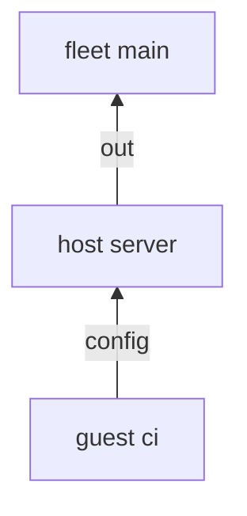

---
{"description":"A sink key that names another sink feeds it. One sink can build another, and a guest can feed its host.","editUrl":"https://github.com/vic/sven/blob/main/docs/examples/forwards/page.nix","title":"Forwards"}
---

import { Aside, Badge, Card, CardGrid, FileTree, LinkButton, LinkCard, Steps, TabItem, Tabs } from '@astrojs/starlight/components';

The keys of a sink, other than `reduce`, `of`, `at` and `out`, give elements to other sinks.
They run at the receiver, with the receiver's args. You already know one: `out` gives to the flake.


```nix title="modules/sinks.nix" {8,15}
# A sink's other keys give elements to other sinks. They run at the receiver, with its args.
{ sven, ... }:
let
  inherit (sven.lib.reduce) merge;
in
{
  sven.kinds.host.sinks = {
    ports.config =
      { ports, ... }:
      {
        firewall.allowedTCPPorts = ports;
      }; # ports feed config
    config = {
      reduce = merge;
      out =
        { host, config, ... }:
        {
          config.${host.name} = config;
        };
    };
  };
  sven.kinds.guest.sinks = {
    ports.config =
      { ports, ... }:
      {
        firewall.allowedTCPPorts = ports;
      };
    config = {
      reduce = merge;
      config =
        { guest, config, ... }:
        {
          vms.${guest.name} = config;
        }; # its own name: a forward up, to the host
    };
  };
}
```

- At a host, `ports` feeds `config`: aspects give port numbers, and the host turns them into firewall config.
- At a guest, `config` has a key with its own name. A sink cannot feed itself, so this forward goes strictly up:
  to the nearest `config` sink above the guest, the host's.


```nix title="modules/fleet.nix"
{ sven, lib, ... }:
{
  sven.kinds.fleet = {
    spawns.host = _: sven.host;
    sinks.out.reduce = sven.lib.reduce.merge;
  };
  sven.kinds.host.spawns.guest = s: lib.filterAttrs (_: g: sven.lib.same g.on s) sven.guest;
  sven.kinds.guest.fields.on = sven.kinds.host;

  sven.fleet.main = { };
  sven.host.server = { };
  sven.guest.ci.on = sven.host.server;
  sven.flake = { out, ... }: out;
}
```

```nix title="modules/aspects.nix"
{ sven, ... }:
{
  sven.aspects.ssh = {
    at = sven.kinds.host;
    ports = 22;
  };
  sven.aspects.runner = {
    at = sven.guest.ci;
    ports = 8080;
    config.runner.enable = true;
  };
}
```

The guest's config arrives inside the host's config, under `vms.ci`:


```nix title="result"
{
  server = {
    firewall = {
      allowedTCPPorts = [
        22
      ];
    };
    vms = {
      ci = {
        firewall = {
          allowedTCPPorts = [
            8080
          ];
        };
        runner = {
          enable = true;
        };
      };
    };
  };
}
```



:::tip[One sink for two systems]
Forwards let one sink serve several targets. A fleet can give `os` elements and forward them to `nixos` on a host
and to `darwin` on a mac. Aspects write `os` once. See [nix-darwin machines](/recipes/darwin/).
:::

:::tip[Run this example]
Every block on this page is a file of the template `forwards`. Copy it and run it:

```sh frame="terminal"
nix flake init -t github:vic/sven#forwards
```

<FileTree>

- flake.nix
- modules/
  - aspects.nix
  - fleet.nix
  - sinks.nix

</FileTree>
:::
