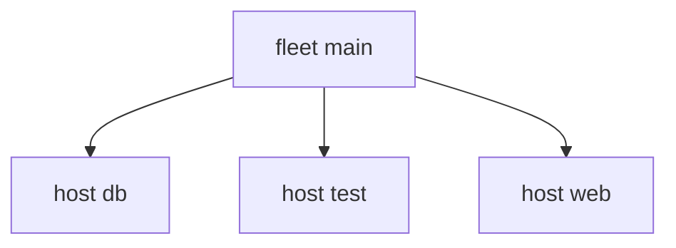

import { Aside, Badge, Card, CardGrid, FileTree, LinkButton, LinkCard, Steps, TabItem, Tabs } from '@astrojs/starlight/components';

A kind is also a type. A field of type `sven.kinds.environment` holds a ref to an environment instance:
`sven.environment.prod`, never the string `"prod"`.


```nix title="modules/kinds.nix"
# A kind is a type too: a field of kind `environment` holds a ref to an environment instance.
# Nothing spawns `environment`, so it is a data kind: its instances have no scope.
{ sven, lib, ... }:
{
  sven.kinds.environment.fields.domain = lib.types.str;
  sven.kinds.host.fields = {
    environment = sven.kinds.environment;
    backup = sven.lib.maybe sven.kinds.host; # a ref to another host, or null
  };
}
```

```nix title="modules/instances.nix" {6-7}
{ sven, ... }:
{
  sven.environment.prod.domain = "example.com";
  sven.environment.lab.domain = "lab.example.com";

  sven.host.web = { environment = sven.environment.prod; backup = sven.host.db; };
  sven.host.db = { environment = sven.environment.prod; backup = sven.host.web; }; # refs can point both ways
  sven.host.test.environment = sven.environment.lab;
}
```

Refs are lazy, so two hosts can point at each other. There is no cycle error.
Follow a ref like an attrset, and compare two instances with `sven.lib.same`:


```nix title="modules/report.nix"
{ sven, lib, ... }:
{
  sven.aspects.report = {
    at = sven.kinds.host;
    report = { host, ... }: {
      ${host.name} = {
        fqdn = "${host.name}.${host.environment.domain}"; # follow a ref, read its fields
        backup = if host.backup == null then null else host.backup.name;
        # `same` compares two instances by kind and name
        peers = lib.attrNames (lib.filterAttrs (n: h: n != host.name && sven.lib.same h.environment host.environment) sven.host);
      };
    };
  };
}
```

```nix title="result"
{
  db = {
    backup = "web";
    fqdn = "db.example.com";
    peers = [
      "web"
    ];
  };
  test = {
    backup = null;
    fqdn = "test.lab.example.com";
    peers = [ ];
  };
  web = {
    backup = "db";
    fqdn = "web.example.com";
    peers = [
      "db"
    ];
  };
}
```

## Data kinds

`environment` is a data kind: no kind spawns it. Its instances have no place in the scope tree,
and refs to them still work. The tree has the fleet and the hosts only:




Groups, channels and secrets are good data kinds. [Scopes](/concepts/scopes/) shows how a kind gets a place in the tree.

## A string is not a ref

A name where a ref goes is an error record, with the fix:


```nix title="variants/string-ref.nix"
# A name where a ref goes.
{ sven, ... }:
{
  sven.host.cache.environment = "prod";
}
```

```nix title="result"
[
  {
    class = "fixable";
    code = "ref";
    error = "environment wants a environment ref";
    fix = "use sven.environment.<name>, not a string";
    from = "host:cache";
    got = "prod";
    path = [
      "environment"
    ];
    want = "a environment ref";
  }
]
```

:::tip[Run this example]
Every block on this page is a file of the template `instances-refs`. Copy it and run it:

```sh frame="terminal"
nix flake init -t 'github:vic/sven?dir=docs#instances-refs'
```

<FileTree>

- flake.nix
- modules/
  - fleet.nix
  - instances.nix
  - kinds.nix
  - report.nix
- variants/
  - string-ref.nix

</FileTree>
:::
