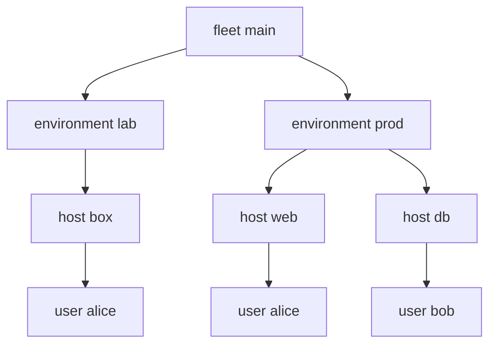

---
{"description":"A scope is one instance at one place in a tree. `spawns` builds the tree from your data.","editUrl":"https://github.com/vic/sven/blob/main/docs/examples/scopes/page.nix","title":"Scopes and spawns"}
---

import { Aside, Badge, Card, CardGrid, FileTree, LinkButton, LinkCard, Steps, TabItem, Tabs } from '@astrojs/starlight/components';

A scope is one instance at one place in the tree. The root kind is the kind that no kind spawns.
`spawns.<kind>` is a function of the parent scope. It gives the instances that live under it.


```nix title="modules/tree.nix" {7,8,11}
# `spawns.<kind>` gives the children of a scope: a function of the parent scope.
{ sven, lib, ... }:
let
  inherit (sven.lib) same is;
in
{
  sven.kinds.fleet.spawns.environment = _: sven.environment;
  sven.kinds.environment.spawns.host = s: lib.filterAttrs (_: h: same h.environment s) sven.host;
  sven.kinds.host = {
    fields.environment = sven.kinds.environment;
    spawns.user = s: lib.filterAttrs (_: u: lib.any (same s) u.hosts) sven.user;
  };
  sven.kinds.user.fields.hosts = is lib.isList; # refs to the hosts the user logs in to

  sven.fleet.main = { };
}
```

```nix title="modules/instances.nix"
{ sven, ... }:
{
  sven.environment.prod = { };
  sven.environment.lab = { };
  sven.host.web.environment = sven.environment.prod;
  sven.host.db.environment = sven.environment.prod;
  sven.host.box.environment = sven.environment.lab;
  sven.user.alice.hosts = [
    sven.host.web
    sven.host.box
  ]; # one user, two scopes
  sven.user.bob.hosts = [ sven.host.db ];
}
```

The tree comes from the data. Nothing lists the children by hand:




## Identity is a path

The id of a scope is its path: `fleet:main/environment:prod/host:web/user:alice`.
One instance can live in several places. `alice` has two scopes, one under each of her hosts.
Names need not be unique.

`r.scopes` gives the scopes in order:


```nix title="result"
[
  "fleet:main"
  "fleet:main/environment:lab"
  "fleet:main/environment:lab/host:box"
  "fleet:main/environment:lab/host:box/user:alice"
  "fleet:main/environment:prod"
  "fleet:main/environment:prod/host:web"
  "fleet:main/environment:prod/host:web/user:alice"
  "fleet:main/environment:prod/host:db"
  "fleet:main/environment:prod/host:db/user:bob"
]
```

## Order

A parent comes before its children. Siblings sort by the `order` sink (default `0`), then by name.
`web` comes before `db` because of this aspect:


```nix title="modules/order.nix"
# Siblings sort by the `order` sink (default 0), then by name. A parent comes before its children.
{ sven, ... }:
{
  sven.aspects.web-first = {
    at = sven.host.web;
    order = -1;
  };
}
```

:::tip[Kinds without scopes]
A kind that no kind spawns is data: its instances have no scope, and refs to them still work.
See [Instances and refs](/concepts/instances-refs/#data-kinds).
:::

## Read the tree inside the fleet

`sven.lib.graph` is readable by any module. This example gives its scope ids as a flake output:


```nix title="modules/outputs.nix"
# The flake gives the scope ids: `sven.lib.graph` is readable inside the fleet.
{ sven, ... }:
{
  sven.kinds.fleet.sinks.out.reduce = sven.lib.reduce.merge;
  sven.flake = { out, ... }: out;
  sven.aspects.tree = {
    at = sven.kinds.fleet;
    out.scopes = map (s: s.id) sven.lib.graph.scopes;
  };
}
```

:::tip[Run this example]
Every block on this page is a file of the template `scopes`. Copy it and run it:

```sh frame="terminal"
nix flake init -t github:vic/sven#scopes
```

<FileTree>

- flake.nix
- modules/
  - instances.nix
  - order.nix
  - outputs.nix
  - tree.nix

</FileTree>
:::
