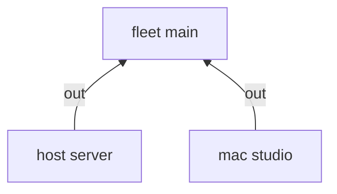

---
{"description":"NixOS hosts and macs in one fleet. Aspects write `os` once; each platform forwards it.","editUrl":"https://github.com/vic/sven/blob/main/docs/examples/darwin/page.nix","title":"nix-darwin machines"}
---

import { Aside, Badge, Card, CardGrid, FileTree, LinkButton, LinkCard, Steps, TabItem, Tabs } from '@astrojs/starlight/components';

Many options mean the same on NixOS and nix-darwin: `networking.hostName`, `environment.systemPackages`,
`nix.settings`. Write them once. A `host` forwards its `os` sink to `nixos`, and a `mac` forwards it to `darwin`.


```nix title="modules/platforms.nix" {9,13}
# Two kinds of machine, one `os` sink: an aspect writes `os` once, and each platform forwards it.
{ sven, inputs, ... }:
{
  sven.kinds.fleet = {
    spawns = {
      host = _: sven.host;
      mac = _: sven.mac;
    };
    sinks.out.reduce = sven.lib.reduce.merge;
  };
  sven.kinds.host.sinks = {
    os.nixos =
      { os, ... }:
      {
        imports = os;
      };
    nixos.out =
      { host, nixos, ... }:
      {
        nixosConfigurations.${host.name} = inputs.nixpkgs.lib.nixosSystem { modules = nixos; };
      };
  };
  sven.kinds.mac.sinks = {
    os.darwin =
      { os, ... }:
      {
        imports = os;
      };
    darwin.out =
      { mac, darwin, ... }:
      {
        darwinConfigurations.${mac.name} = inputs.nix-darwin.lib.darwinSystem { modules = darwin; };
      };
  };

  sven.fleet.main = { };
  sven.flake = { out, ... }: out;
}
```

```nix title="modules/shared.nix"
# Written once, for every machine: options that NixOS and nix-darwin share.
{ sven, ... }:
{
  sven.aspects.shared = {
    at = [
      sven.kinds.host
      sven.kinds.mac
    ];
    os =
      { scope, pkgs, ... }:
      {
        networking.hostName = scope.name;
        environment.systemPackages = [ pkgs.git ];
        nix.settings.experimental-features = [
          "nix-command"
          "flakes"
        ];
      };
  };
}
```

```nix title="modules/machines.nix"
{ sven, ... }:
{
  sven.host.server = { };
  sven.mac.studio = { };

  sven.aspects.server = {
    at = sven.host.server;
    nixos = {
      boot.loader.grub.device = "nodev";
      fileSystems."/" = {
        device = "/dev/sda1";
        fsType = "ext4";
      };
      nixpkgs.hostPlatform = "x86_64-linux";
      system.stateVersion = "25.05";
    };
  };
  sven.aspects.studio = {
    at = sven.mac.studio;
    darwin = {
      nixpkgs.hostPlatform = "aarch64-darwin";
      system.stateVersion = 6;
    };
  };
}
```

The routes: `shared` gives `os` at each machine, and each `os` sink feeds its platform's sink:




```sh frame="terminal"
sudo nixos-rebuild switch --flake .#server
sudo darwin-rebuild switch --flake .#studio
```

:::note[Platform-only content]
Keep platform-only options under their own key: `nixos` for NixOS, `darwin` for nix-darwin. An aspect active at both
kinds can give `os`, `nixos` and `darwin` at the same time; each element goes where its sink is.
:::

:::tip[Run this example]
Every block on this page is a file of the template `darwin`. Copy it and run it:

```sh frame="terminal"
nix flake init -t github:vic/sven#darwin
```

<FileTree>

- flake.nix
- modules/
  - machines.nix
  - platforms.nix
  - shared.nix

</FileTree>
:::
