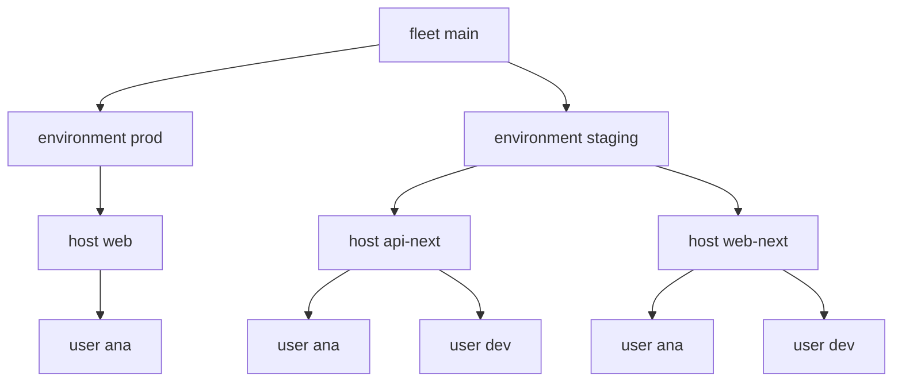

import { Aside, Badge, Card, CardGrid, FileTree, LinkButton, LinkCard, Steps, TabItem, Tabs } from '@astrojs/starlight/components';

An environment owns its hosts. It gives them a domain and default settings, and it decides which people
may log in. staging inherits from prod what it does not set.


```nix title="modules/kinds.nix" {17,23}
# fleet > environment > host > user. Groups are data: an environment grants groups, a user is in groups.
{ sven, lib, inputs, ... }:
let
  inherit (sven.lib) same maybe opt is;
  listOf = t: is (v: lib.isList v && lib.all t.check v);
  meets = xs: ys: lib.any (x: lib.any (same x) ys) xs;
in
{
  sven.kinds.fleet = {
    spawns.environment = _: sven.environment;
    sinks.out.reduce = sven.lib.reduce.merge;
  };
  sven.kinds.group = { };
  sven.kinds.environment = {
    fields = {
      domain = lib.types.str;
      base = maybe sven.kinds.environment; # settings it does not set come from here
      grants = opt (listOf sven.kinds.group) [ ];
      settings.timeZone = maybe lib.types.str;
    };
    spawns.host = s: lib.filterAttrs (_: h: same h.environment s) sven.host;
  };
  sven.kinds.host = {
    fields = { environment = sven.kinds.environment; settings.timeZone = maybe lib.types.str; };
    spawns.user = s: lib.filterAttrs (_: u: meets u.groups s.environment.grants) sven.user; # access from data
    sinks.nixos.out = { host, nixos, ... }: {
      nixosConfigurations.${host.name} = inputs.nixpkgs.lib.nixosSystem { modules = nixos; };
    };
  };
  sven.kinds.user.fields.groups = listOf sven.kinds.group;

  sven.fleet.main = { };
  sven.flake = { out, ... }: out;
}
```

```nix title="modules/data.nix"
{ sven, ... }:
{
  sven.group = { admins = { }; devs = { }; };
  sven.environment.prod = { domain = "example.com"; grants = [ sven.group.admins ]; settings.timeZone = "UTC"; };
  sven.environment.staging = { domain = "staging.example.com"; base = sven.environment.prod; grants = [ sven.group.admins sven.group.devs ]; };
  sven.host.web = { environment = sven.environment.prod; };
  sven.host.web-next = { environment = sven.environment.staging; settings.timeZone = "Europe/Berlin"; };
  sven.host.api-next = { environment = sven.environment.staging; };
  sven.user.ana.groups = [ sven.group.admins ];
  sven.user.dev.groups = [ sven.group.devs ];
}
```

Users are not listed per host. A user lives on a host when one of their groups is in the environment's `grants`:




## Settings cascade

`sven.lib.cascade` takes the first value along host, environment, base environment:


```nix title="modules/base.nix" {4}
# Settings cascade: the host, then its environment, then the environment's base.
{ sven, ... }:
let
  setting = path: host: sven.lib.cascade path [ host host.environment (host.environment.base or null) ];
in
{
  sven.aspects.base = {
    at = sven.kinds.host;
    nixos = { host, environment, ... }: {
      networking = { hostName = host.name; domain = environment.domain; };
      time.timeZone = setting [ "settings" "timeZone" ] host;
      boot.loader.grub.device = "nodev";
      fileSystems."/" = { device = "/dev/sda1"; fsType = "ext4"; };
      nixpkgs.hostPlatform = "x86_64-linux";
      system.stateVersion = "25.05";
    };
  };
  sven.aspects.time-zones = {
    at = sven.kinds.host;
    out = { host, ... }: { timeZones.${host.name} = setting [ "settings" "timeZone" ] host; }; # goes up to the fleet
  };
  sven.aspects.account = {
    at = sven.kinds.user;
    nixos = { user, ... }: { users.users.${user.name}.isNormalUser = true; };
  };
}
```

```nix title="result"
{
  api-next = "UTC";
  web = "UTC";
  web-next = "Europe/Berlin";
}
```

:::tip[Promote a host]
Move `web-next` to prod with one edit: `environment = sven.environment.prod`. Its domain, its time zone default
and its users follow from the data.
:::

:::tip[Run this example]
Every block on this page is a file of the template `environments`. Copy it and run it:

```sh frame="terminal"
nix flake init -t 'github:vic/sven?dir=docs#environments'
```

<FileTree>

- flake.nix
- modules/
  - base.nix
  - data.nix
  - kinds.nix

</FileTree>
:::
