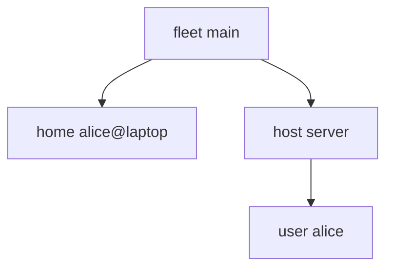

---
{"description":"home-manager inside NixOS and as a standalone home, from one aspect.","editUrl":"https://github.com/vic/sven/blob/main/docs/examples/users-homes/page.nix","title":"Users and homes"}
---

import { Aside, Badge, Card, CardGrid, FileTree, LinkButton, LinkCard, Steps, TabItem, Tabs } from '@astrojs/starlight/components';

A person uses several machines. Some run NixOS, some only home-manager. In sven the person is data,
and their home is one aspect that is active in both places.


```nix title="modules/fleet.nix" {17-20,22-28}
# Hosts build NixOS and hold their users. Homes are standalone home-manager configurations.
{ sven, lib, inputs, ... }:
let
  inherit (sven.lib) same is;
in
{
  sven.kinds.fleet = {
    spawns = { host = _: sven.host; home = _: sven.home; };
    sinks.out.reduce = sven.lib.reduce.merge;
  };
  sven.kinds.host = {
    spawns.user = s: lib.filterAttrs (_: u: lib.any (same s) u.hosts) sven.user;
    sinks.nixos.out = { host, nixos, ... }: {
      nixosConfigurations.${host.name} = inputs.nixpkgs.lib.nixosSystem { modules = nixos; };
    };
  };
  sven.kinds.user = {
    fields.hosts = is lib.isList;
    sinks.homeManager.nixos = { user, homeManager, ... }: { home-manager.users.${user.name}.imports = homeManager; };
  };
  sven.kinds.home = {
    fields = { user = sven.kinds.user; system = lib.types.str; };
    sinks.homeManager.out = { home, homeManager, ... }: {
      homeConfigurations.${home.name} = inputs.home-manager.lib.homeManagerConfiguration {
        pkgs = inputs.nixpkgs.legacyPackages.${home.system};
        modules = homeManager;
      };
    };
  };
  sven.aspects.home-manager = {
    at = sven.lib.has sven.kinds.user;
    nixos = { imports = [ inputs.home-manager.nixosModules.home-manager ]; home-manager.useGlobalPkgs = true; };
  };

  sven.fleet.main = { };
  sven.flake = { out, ... }: out;
}
```

- A `user` lives under each host in its `hosts`. Its `homeManager` sink forwards into the host's NixOS.
- A `home` lives under the fleet. Its `homeManager` sink builds `homeConfigurations.<name>`.


```nix title="modules/alice.nix" {6}
# alice: an account on the server, and a standalone home for her laptop (any Linux, no NixOS).
{ sven, ... }:
let
  alice = sven.user.alice;
  # her own scopes, and every home that belongs to her
  hers = [ alice (s: s.kind == "home" && sven.lib.same s.user alice) ];
in
{
  sven.user.alice.hosts = [ sven.host.server ];
  sven.home."alice@laptop" = { user = alice; system = "x86_64-linux"; };

  sven.aspects.alice-account = {
    at = alice;
    nixos.users.users.alice = { isNormalUser = true; extraGroups = [ "wheel" ]; };
  };
  sven.aspects.alice-home = {
    at = hers; # one home config, in NixOS and standalone
    homeManager = {
      programs.git = { enable = true; userName = "Alice"; };
      home.stateVersion = "25.05";
    };
  };
  sven.aspects.standalone = {
    at = sven.kinds.home;
    homeManager = { home, ... }: { home.username = home.user.name; home.homeDirectory = "/home/${home.user.name}"; };
  };
}
```

```nix title="modules/machines.nix"
{ sven, ... }:
{
  sven.host.server = { };
  sven.aspects.server = {
    at = sven.host.server;
    nixos = {
      networking.hostName = "server";
      boot.loader.grub.device = "nodev";
      fileSystems."/" = { device = "/dev/sda1"; fsType = "ext4"; };
      nixpkgs.hostPlatform = "x86_64-linux";
      system.stateVersion = "25.05";
    };
  };
}
```

`alice-home` is active at alice's user scope and at her home:


```nix title="result"
{
  "fleet:main" = false;
  "fleet:main/home:alice@laptop" = true;
  "fleet:main/host:server" = false;
  "fleet:main/host:server/user:alice" = true;
}
```



```sh frame="terminal"
sudo nixos-rebuild switch --flake .#server
home-manager switch --flake '.#alice@laptop'
```

:::tip[A home that reads its host]
A home can also live under a host: give `host` a `spawns.home`. The home then reads the host's sinks like any child,
and still builds its own `homeConfigurations`. A home's sink with no keys keeps its content away from the host.
See [Routing and walls](/concepts/routing/#walls).
:::

:::tip[Run this example]
Every block on this page is a file of the template `users-homes`. Copy it and run it:

```sh frame="terminal"
nix flake init -t 'github:vic/sven?dir=docs#users-homes'
```

<FileTree>

- flake.nix
- modules/
  - alice.nix
  - fleet.nix
  - machines.nix

</FileTree>
:::
