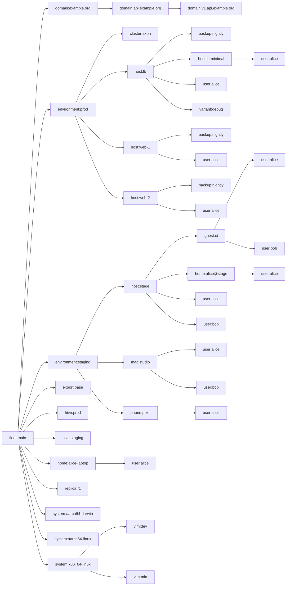

# sven fleet

<!-- Generated by github:sini/files from modules/docs. Edit there, then run `nix run .#write-files`. -->

## What sven is

sven is a query language for Nix configurations. You declare data and behavior in plain Nix files. sven answers queries on them: the NixOS systems, the homes, the flake outputs, the errors, the graph.

sven is a small Nix file with no dependencies. It uses builtins only. It does not use nixpkgs, the module system or flakes. It never calls `throw`: an error is data that you query.

sven follows [Cycle.js](https://cycle.js.org): a component reads sources and writes sinks, and drivers answer the sinks. In Nix, laziness closes the loop. There is no `evalModules` fixpoint and no merge step. A value is computed only when something reads it.

This fleet is the reference example. It models the [Ren](https://github.com/vic/ren) fleet template, every capability of [Den](https://github.com/denful/den) and of den-hoag (Den on Gen), and the advanced cases of four real configurations (sini, swarsel, adda, vix). Every section below points to the file that shows it.

## Start

```nix
# flake.nix
{
  inputs.sven = { url = "github:vic/sven"; flake = false; };
  inputs.import-tree.url = "github:denful/import-tree";
  inputs.nixpkgs.url = "github:nixos/nixpkgs/nixos-25.05";
  outputs = inputs: (import inputs.sven).lib.mkFlake {
    imports = [ (inputs.import-tree ./modules) ];
    _module.args = { inherit inputs; inherit (inputs.nixpkgs) lib; };
  };
}
```

sven reads one module. A module is a path, a function or an attrset, with three keys: `imports`, `_module.args` and `sven`. sven does not know what `inputs` or `lib` are. You give them as args, and they flow down the `imports` tree to every file below.

A file in `modules/` looks like this:

```nix
{ sven, lib, ... }:
{
  sven.kinds.host.fields.addr = lib.types.str;
  sven.host.lb.addr = "10.0.1.1";
  sven.aspects.motd = {
    at = sven.kinds.host;
    nixos.environment.etc.motd.text = "managed by sven";
  };
}
```

Without flakes, call `(import ./sven).lib.eval module`. The result is a set of queries (see [Queries](#queries)).

## Kinds and instances

A kind is a type of thing: `host`, `user`, `environment`. Its `fields` are the data of each instance.

```nix
sven.kinds.host.fields = {
  addr = lib.types.str;                      # any value with `check` is a type
  environment = sven.kinds.environment;      # a kind is a type too: a ref to an instance
  buildHost = sven.lib.maybe lib.types.str;  # null by default
  settings.kernel.channel = sven.lib.maybe (sven.helpers.enum [ "lts" "latest" ]);
};
sven.host.lb = { addr = "10.0.1.1"; environment = sven.environment.prod; };
```

A type is anything with `check = value: bool`. `lib.types`, your own `sven.lib.is builtins.isString`, and kinds all work. sven has no type system of its own. `sven.lib.opt type default` and `sven.lib.maybe type` add a default.

Fields are strict. A missing field, an unknown field, a failed check, or a string where a ref goes is an error record. The read gives `null`, and evaluation continues.

## Data is queried, not merged

Two files can declare types at two paths of one field. sven does not merge them. A read of a path is one query on the files that answer that path.

```nix
# features/zfs.nix
sven.kinds.machine.fields.settings.zfs.arcMax = sven.lib.maybe lib.types.int;
# features/k3s.nix
sven.kinds.machine.fields.settings.k3s.role = sven.lib.opt lib.types.str "agent";
```

A read of `host.settings.k3s.role` looks at the instance first, then at the type defaults, then checks the value. It never touches `zfs.nix`. Compare: a nixpkgs `submodule` runs one more `evalModules` for each value.

A cascade is a list in your order. `sven.lib.cascade path xs` gives the first non-null value along `xs` ([sini/settings.nix](modules/sini/settings.nix)):

```nix
setting = path: h: sven.lib.cascade path ([ h ] ++ h.environment.delegates ++ [ h.environment ]);
```

## Scopes: where things live

A scope is one instance at one place in a tree. The root kind has `spawns` and no kind spawns it. `spawns.<kind>` gives the children of a scope:

```nix
sven.kinds.environment.spawns.host = s: lib.filterAttrs (_: h: sven.lib.same h.environment s) sven.host;
```

The identity of a scope is its path: `fleet:main/environment:prod/host:lb`. One name can live in two places. In this fleet, `host:lb-minimal` lives under `host:lb` ([swarsel/variants.nix](modules/swarsel/variants.nix)). Names need not be unique.

A kind that no kind spawns is data: `group`, `channel`, `secret`. Its instances have no scope, and refs to them still work.

Siblings sort by the `order` sink (default `0`), then by key. A parent comes before its children.

## Aspects: behavior at scopes

An aspect is active at every scope where its `at` predicate holds. It gives elements to sinks by key.

```nix
sven.aspects.nginx = {
  at = [ sven.host.web-1 sven.host.web-2 sven.aspects.status ];  # a list is "any"
  nixos.services.nginx.enable = true;   # one element to the `nixos` sink
  backends = { host, ... }: host.addr;  # one element to the `backends` sink
  persist = "/var/lib/nginx";
};
```

A predicate is a function `scope: bool`. A kind ref, an instance ref, an aspect ref and a list are predicates too. Combine them with `sven.lib.all`, `not`, `within` (a proper ancestor holds) and `has` (a child holds).

`at` from several files is a union. To replace an aspect at one scope, put `not` in its `at` and write your own aspect ([features/motd.nix](modules/features/motd.nix)).

An aspect is active only at the scope where `at` holds. It never flows down to children: a host profile does not reach the host's guests.

## Sinks: where elements go

A sink on a kind collects elements and reduces them:

```nix
sven.kinds.host.sinks.persist = { reduce = sven.lib.reduce.set; of = lib.types.str; };
```

| Reduce | Value | Error |
|---|---|---|
| `list` (default) | the elements in scope order | none |
| `set` | the elements without duplicates | none |
| `one` | the single element | 0 or 2+ elements |
| `merge` | a deep attrset | two different leaves at one path |
| `entries` | `[ { from; value; } ]`: the giving scope comes with each value | none |

An element goes to the nearest ancestor-or-self scope that has the sink and where the sink's `at` holds. A user under host `lb` gives `os`. The user has no `os` sink, the host has one, so the element goes to `lb`. The same user under a mac goes to the mac.

A sink's other keys give elements to other sinks. They run at the receiver, with the receiver's args:

```nix
sven.kinds.host.sinks.os.nixos = { os, ... }: { imports = os; };        # os feeds nixos: one `os` for NixOS and darwin
sven.kinds.guest.sinks.nixos.nixos = { guest, nixos, ... }: {           # its own name: a forward, strictly up
  microvm.vms.${guest.name}.config.imports = nixos;
};
```

A sink that nobody reads is not an error. Nothing happens. A sink with no keys is a wall: `sven.kinds.home.sinks.os = { }` keeps a home's elements away from the host above it.

The `out` sink of the root is the flake. `sven.flake = { out, ... }: out;` gives it.

## Args: reading data

An element can be a function with named args. sven fills the args it knows:

| Arg | Value |
|---|---|
| a kind name (`host`, `environment`) | the nearest ancestor-or-self scope of that kind |
| a sink name (`backends`, `persist`) | the reduced value of that sink at its nearest receiver |
| `scope` | the scope itself |

Other args (`pkgs`, `lib`, `config`) stay open. The element is then a module function for NixOS or home-manager, with sven's args already filled.

If an arg has no answer, the element is not given, and `errors` lists it. `{ cluster ? null, ... }` makes the arg optional. A bare `final: prev:` is an error: wrap it as `{ ... }: final: prev: …`.

## The cycle form

The keys above give one element each. For 0 to n elements, or to ask the tree for data, write a component:

```nix
sven.aspects.kernel = {
  at = sven.kinds.host;
  cycle = { tree, ... }: {
    tree = [ { category = "env"; nearest = sven.kinds.environment; } ];   # a request
    nixos = map (env: { boot.kernelParams = [ "env=${env.name}" ]; }) (tree.select "env");
    errors = [ ];                                                          # a component can report errors
  };
};
```

Tree requests: `nearest = <kind>`, `parent = true`, `children = <predicate>`, `scopesOf = <instance>`, `holds = <predicate>`.

## Queries

`sven.lib.eval module` gives queries, not one value:

| Query | Answer |
|---|---|
| `errors` | `[ { error; from; } ]`, empty when the fleet is valid |
| `graph` | `{ scopes; edges; }`: every scope and every routed element |
| `scopes` | the scopes in order |
| `active` | aspect, then scope id, then `true` or `false` |
| `reduced` | sink, then receiver id, then the value |
| `flake` | the answer of `sven.flake` |

`sven.lib.graph` is readable inside the fleet. The `docs` aspect makes a mermaid chart from it, and this README uses it too.

## Patterns in this fleet

| Pattern | From | File |
|---|---|---|
| hosts from JSON, refs from names | Ren | [hosts/inventory.nix](modules/hosts/inventory.nix) |
| users on machines from nested group grants | Ren, Den | [helpers.nix](modules/helpers.nix), [topology/access.nix](modules/topology/access.nix) |
| one `os` sink for NixOS and darwin | Ren #76 | [platforms/nixos.nix](modules/platforms/nixos.nix), [platforms/darwin.nix](modules/platforms/darwin.nix) |
| microvm guest forwards into its host | Ren, Den | [platforms/microvm.nix](modules/platforms/microvm.nix) |
| a diamond lands once per scope | Den #468 | [features/web.nix](modules/features/web.nix) |
| substitute with `not` | Den | [features/motd.nix](modules/features/motd.nix) |
| a check that reads a built system | Ren #60 | [topology/systems.nix](modules/topology/systems.nix) |
| specialisations as a variant kind | Den | [platforms/variants.nix](modules/platforms/variants.nix) |
| deterministic ids from sorted names | Den | [den/ids.nix](modules/den/ids.nix) |
| a standalone home that reads its host's data | Den #739 | [den/standalone-home-on-host.nix](modules/den/standalone-home-on-host.nix) |
| discovery: k3s nodes per cluster, ingest across environments | sini | [sini/clusters.nix](modules/sini/clusters.nix) |
| recursive kinds: domains under domains | sini | [sini/domains.nix](modules/sini/domains.nix) |
| conditional receivers: terranix, unifi | sini | [sini/network.nix](modules/sini/network.nix) |
| a mesh: each host reads its peers, drops itself | sini | [sini/mesh.nix](modules/sini/mesh.nix) |
| settings cascade with delegation | sini | [sini/settings.nix](modules/sini/settings.nix) |
| tags from active role aspects | sini | [sini/roles.nix](modules/sini/roles.nix) |
| one sink name on three kinds | sini | [sini/secrets.nix](modules/sini/secrets.nix) |
| a trust filter on the reader side | sini | [sini/xmsg.nix](modules/sini/xmsg.nix) |
| devshell, formatter, hooks: sink to sink | sini | [sini/flake.nix](modules/sini/flake.nix) |
| one machine, two builds | swarsel | [swarsel/variants.nix](modules/swarsel/variants.nix) |
| one machine writes config into another, and fleet globals | swarsel | [swarsel/distributed.nix](modules/swarsel/distributed.nix) |
| aspects exported as `nixosModules` | swarsel, Den | [swarsel/exports.nix](modules/swarsel/exports.nix) |
| service domains into a reverse proxy, and flake templates | adda | [adda/services.nix](modules/adda/services.nix) |
| a child kind declared in another file, and feature gates | vix | [vix/editors.nix](modules/vix/editors.nix) |
| secrets as a data kind | vix | [vix/secrets.nix](modules/vix/secrets.nix) |

### Den #739: a standalone home that reads host data

In [den#739](https://github.com/denful/den/discussions/739), a Den user wants host data (a monitor) in a standalone home `tux@igloo`. Den pipes the data to a home-manager module home only.

In sven, where a scope lives (`spawns`) and what it builds (`out`) are separate. The home `alice@stage` lives under host `stage`:

```nix
sven.kinds.host.spawns.home = s: lib.filterAttrs (_: h: sven.lib.same h.on s) sven.home;
sven.home."alice@stage" = { user = sven.user.alice; on = sven.host.stage; /* … */ };
sven.aspects.monitor-env.homeManager = { monitor ? null, ... }: { home.sessionVariables.MONITORRES = monitor.resolution; };
```

The home reads stage's `monitor` sink like any child. It still builds its own `homeConfigurations."alice@stage"`. Its `os` sink is a wall, so its users do not change stage's NixOS.

## sven, Den and Den on Gen

[Den](https://github.com/denful/den) has 1,365 CI tests. [den-hoag](https://github.com/sini/den-hoag), Den's next version on the [Gen](https://github.com/sini/gen) libraries, has 18 laws. This fleet shows each of their capabilities with sven's four words. Every row has a check in `tests.nix`.

| Den / den-hoag | sven | File |
|---|---|---|
| `den.default`, schema includes, batteries | an aspect with `at = sven.kinds.<kind>` | [den/batteries.nix](modules/den/batteries.nix) |
| includes, excludes, substitute, instance-side includes | `at` with aspect refs, `not`, `at` from any file | [features/motd.nix](modules/features/motd.nix), [sini/roles.nix](modules/sini/roles.nix) |
| custom classes, chained forwards (hjem, maid) | a user sink whose keys feed other sinks | [den/custom-classes.nix](modules/den/custom-classes.nix) |
| `hasAspect`, projected `hasAspect` | `sven.lib.holds`, and `graph` edges with `origin` | [sini/roles.nix](modules/sini/roles.nix) |
| a policy gated on `hasAspect` that creates structure (#525) | `spawns` that reads `holds` at the parent | [den/presence-structure.nix](modules/den/presence-structure.nix) |
| quirks and pipes: collect, expose, broadcast, provenance | a sink at a common ancestor with `entries`, and a filter in the reader | [sini/clusters.nix](modules/sini/clusters.nix) |
| a value that reads a realized config (#713, `osConfig`) | read `out.nixosConfigurations.<host>.config`, lazily | [den/standalone-home-on-host.nix](modules/den/standalone-home-on-host.nix) |
| settings layers with authority, the projects facet (A8, A14) | a sink with your own reduce | [hoag/settings.nix](modules/hoag/settings.nix) |
| claim and provide, "who claims me" | an `entries` sink and a reader filter | [hoag/claims.nix](modules/hoag/claims.nix) |
| collectors: an aggregate with its own content | a `hive` kind that selects its members | [hoag/collectors.nix](modules/hoag/collectors.nix) |
| relations and the query calculus (`rel*`, layers) | plain Nix over ref fields, with `genericClosure` | [hoag/relations.nix](modules/hoag/relations.nix) |
| permutation-stable output (A12), per-member laziness (A17) | file order never changes a result, and sinks are lazy per receiver | `tests.nix`: `den-permutation-stable`, `den-sibling-laziness` |

sven needs no strata, no effect runtime and no registry of merge algebras. The Nix lazy `let` is the only fixpoint. Structure can depend on presence at a parent, and two hosts can point at each other with no cycle error.

Three families of Den bugs cannot happen in sven:

- **Double delivery.** An element has one id per receiver.
- **Lost content when one aspect is in two files.** A read queries all files. Nothing merges early.
- **A host's home-manager content leaking to its users.** Elements go up the tree, never down.

## Generated files and checks

`flake.nix`, `README.md` and `ci.json` are generated. Do not edit them. Edit `modules/`, then run:

```sh
nix run .#write-flake    # flake.nix from the `flake-file` sink (github:vic/flake-file)
nix run .#write-files    # README.md and ci.json (github:sini/files)
nix flake check          # fails if a generated file is stale
```

Each aspect declares the flake inputs it uses on the `flake-file` sink. The generated `flake.nix` has exactly those inputs.

`nix flake check` runs these checks on `x86_64-linux`:

| Check | What it proves |
|---|---|
| `flake-file` | `flake.nix` matches the inputs that the aspects declare |
| `files/README.md`, `files/ci.json` | the committed files match the fleet |
| `infra-<host>` | each fact that aspects state from fleet data holds in the built system: the hostname, nginx and port 80 where nginx is active, every persisted directory |
| `lb-no-gui` | lb's built system has no GUI package |
| `web` | a VM test: a client reaches nginx |
| `pre-commit` | the hooks that aspects give |

The infra checks come from the fleet, not from a hand-written list. Add an aspect that states a fact, and every host where it is active gets the check.

`ci.json` is the CI matrix: one job for each host, mac, home and devshell. It is a generated file, so `files/ci.json` fails when the fleet changes and nobody regenerated the matrix.

## Tests

From this directory:

```sh
nix eval --impure --file tests.nix failed       # [ ]: a check for each pattern above
nix eval --impure --file tests.nix e2e.failed   # [ ]: real NixOS, darwin and home-manager evaluations
```

## This fleet, live

Generated from the fleet's queries: 43 scopes, 23 kinds, 113 aspects, 606 routed elements.

| Kind | Fields | Spawns | Sinks | Scopes |
|---|---|---|---|---|
| `backup` |  |  | `nixos` | 3 |
| `channel` | `darwin`, `home-manager`, `nixpkgs` |  |  | 0 |
| `cluster` | `environment`, `hosts`, `ingestUrl` |  | `age-secrets`, `k8s-manifests` | 1 |
| `db` | `zone` |  |  | 0 |
| `domain` | `mail`, `under` | `domain` |  | 3 |
| `environment` | `base`, `delegates`, `dns`, `edge`, `grants`, `monitoring`, `settings`, `unifi` | `cluster`, `host`, `mac`, `phone` | `backends`, `k3s-nodes`, `mesh-peers`, `port-forwards`, `terraform`, `terranix`, `unifi` | 2 |
| `export` |  |  | `os` | 1 |
| `fleet` |  | `domain`, `environment`, `export`, `hive`, `home`, `replica`, `system` | `certificate-domains`, `ci`, `colmena`, `db-claims`, `dns-records`, `flake-file`, `globals`, `infra`, `monitoring-ingest`, `nodes`, `out`, `overlays`, `records`, `replicate-home`, `scrape`, `syncthing-peers`, `templates`, `vars`, `xmsg-nodes` | 1 |
| `group` | `members` |  |  | 0 |
| `guest` | `addr`, `buildHost`, `builder`, `channel`, `dbOn`, `dependsOn`, `environment`, `minimal`, `on`, `settings`, `system`, `system-owner`, `unpersist` | `user` | `age-secrets`, `nixos`, `os`, `persist`, `unfree` | 1 |
| `hive` | `environment` |  | `meta` | 2 |
| `home` | `channel`, `on`, `system`, `user` | `user` | `homeManager`, `os` | 2 |
| `host` | `addr`, `buildHost`, `builder`, `channel`, `dbOn`, `dependsOn`, `environment`, `minimal`, `settings`, `system`, `system-owner`, `unpersist` | `backup`, `guest`, `home`, `host`, `user`, `variant` | `age-secrets`, `aspect-settings`, `deploy`, `monitor`, `nixos`, `os`, `persist`, `service-domains`, `tags`, `unfree` | 5 |
| `mac` | `addr`, `buildHost`, `builder`, `channel`, `dbOn`, `dependsOn`, `environment`, `minimal`, `settings`, `system`, `system-owner`, `unpersist` | `user` | `darwin`, `os` | 1 |
| `machine` | `addr`, `buildHost`, `builder`, `channel`, `dbOn`, `dependsOn`, `environment`, `minimal`, `settings`, `system`, `system-owner`, `unpersist` |  |  | 0 |
| `phone` | `channel`, `environment`, `system` | `user` | `droid`, `homeManager` | 1 |
| `region` | `zone` |  |  | 0 |
| `replica` | `db`, `region` |  |  | 1 |
| `secret` | `sopsKey` |  |  | 0 |
| `system` |  | `vim` | `checks`, `devshell`, `files`, `git-hooks`, `no-gui`, `packages`, `treefmt` | 3 |
| `user` | `groups`, `phone`, `shell` |  | `account`, `age-secrets`, `files`, `git`, `homeDarwin`, `homeLinux`, `homeManager`, `secrets` | 13 |
| `variant` | `of` |  | `nixos` | 1 |
| `vim` | `features`, `theme` |  | `vim` | 2 |

A kind with 0 scopes is data: nothing spawns it.

### Scope tree



### CI jobs (`ci.json`)

| Job | System | Builds |
|---|---|---|
| `alice-laptop` | `x86_64-linux` | `homeConfigurations."alice-laptop".activationPackage` |
| `alice@stage` | `x86_64-linux` | `homeConfigurations."alice@stage".activationPackage` |
| `devshell-aarch64-darwin` | `aarch64-darwin` | `devShells.aarch64-darwin.default` |
| `devshell-aarch64-linux` | `aarch64-linux` | `devShells.aarch64-linux.default` |
| `devshell-x86_64-linux` | `x86_64-linux` | `devShells.x86_64-linux.default` |
| `lb` | `x86_64-linux` | `nixosConfigurations.lb.config.system.build.toplevel` |
| `stage` | `x86_64-linux` | `nixosConfigurations.stage.config.system.build.toplevel` |
| `studio` | `aarch64-darwin` | `darwinConfigurations.studio.config.system.build.toplevel` |
| `web-1` | `x86_64-linux` | `nixosConfigurations.web-1.config.system.build.toplevel` |
| `web-2` | `x86_64-linux` | `nixosConfigurations.web-2.config.system.build.toplevel` |
